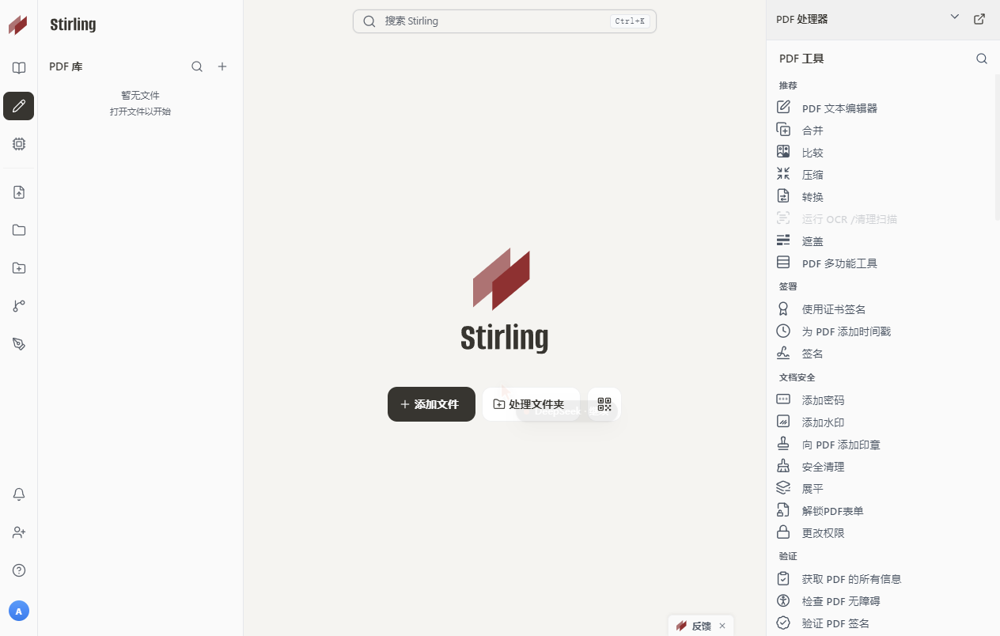
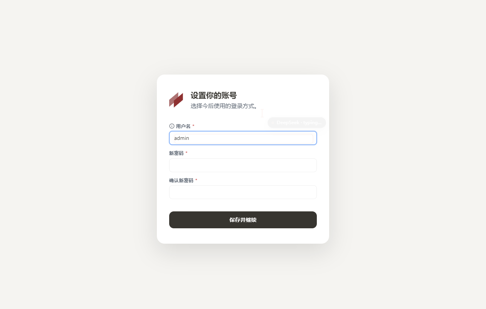

<p align="center">
  
</p>

<h1 align="center">Stirling PDF 简体中文汉化版</h1>

<p align="center">
  基于 Stirling-PDF v3.3.0 的完整简体中文汉化构建
</p>

<p align="center">
  <a href="https://pdf.cjers.top/download/StirlingPDF-CN-Setup-3.3.1.exe">下载</a> ·
  <a href="https://app.cjers.top">在线试用</a> ·
  <a href="https://github.com/Stirling-Tools/Stirling-PDF">上游项目</a>
</p>

---

## 这是什么

[Stirling PDF](https://github.com/Stirling-Tools/Stirling-PDF) 是一个功能强大的开源 PDF 处理平台：编辑、签名、涂黑、转换、OCR、压缩、合并拆分，全部在你自己的机器上完成，文档不会发往任何外部服务。

本仓库是它的**简体中文汉化版**。上游虽然内置了中文语言，但简体中文长期停留在约 91% 的覆盖率——无障碍检查、企业管理门户、首次启动向导、PDF 文本编辑器等模块有大量条目缺失，界面上会直接显示英文键名或英文原文。

本汉化版把这些补齐了，并把简体中文设为默认语言。

## 汉化完成度

| 指标 | 上游 v3.3.0 | 本汉化版 |
|---|---|---|
| 词条总数 | 10706 | 10706 |
| 缺失词条 | 682 | **0** |
| 占位符错误的词条 | 9 | **0** |
| 过期/多余词条 | 20 | **0** |
| 有效覆盖率 | 91.66% | **98.16%** |

> 剩下 1.84%（197 条）是有意保留的原文：产品名（Stirling Cloud、Google Drive、OneDrive）、协议名（SAML2、OAuth2）、格式名（PDF/A-1b、CBR → PDF）、HTTP 状态码、示例占位符（`your@email.com`、`/data/inbox`）。这类内容翻译反而会让用户找不到对应项。

逐条对照：**[汉化差异清单](docs/汉化差异清单.md)**




### 汉化的模块

- **无障碍检查（PDF/UA）**：194 条 —— 规则说明、违规提示、人工检查清单、报告导出
- **企业管理门户**：176 条 —— 云连接配置、企业版试用与报价、采购流程、数据源接入
- **首次启动向导**：122 条 —— 账号、地址、AI、邮件、文件、登录方式、语言
- **PDF 文本编辑器**：86 条 —— 扫描字体匹配、可访问性标签、语言标注
- **其余**：连接账号、支付、反馈、设置、侧边栏、签名等 104 条

### 顺带修掉的上游 bug

上游简体中文里，有 9 处词条把模板占位符**写死成了固定值**，导致界面显示错误的数字：

- `plan.features.usersIncluded`：`{{users}} users included` 被写成「包含 100 位用户」——不管实际买的是几席位，永远显示 100
- `payment.perUserBlock`、`portal.billing.team.midPrice` 等 6 处的 `{{users}}` 同样被写死
- `pdfTextEditor.inspector.fontGap`：`{{fallback}}` 被写死成 `Helvetica`

这些占位符在本汉化版中全部恢复为变量。

### 默认语言

- `settings.yml` 的 `system.defaultLocale` 默认值改为 `zh-CN`
- 后端的 locale 兜底从 `Locale.US` 改为 `Locale.SIMPLIFIED_CHINESE`
- 前端语言优先级为：用户手动选择 > 服务端默认 > 浏览器检测 > 兜底

结果：新访客打开即中文界面，用户仍可在右上角切换任意语言。

### 移动端页面

手机扫码上传、手机手绘签名、API 落地页这三张手写页面原本是硬编码英文，已全部汉化。

## 下载安装（Windows）

**国内直连下载（推荐）**：<https://pdf.cjers.top/download/StirlingPDF-CN-Setup-3.3.1.exe>

GitHub 备用：到 [Releases](https://github.com/cjer007/Stirling-PDF-ZH/releases/latest) 下载同名文件。

也可以直接在线试用，不用下载：<https://pdf.cjers.top>（页面上「立即在线使用」）

- 内置 Java 运行时，**不需要另装 Java**
- 装完桌面有快捷方式，首次运行进入中文配置向导
- 装到 `%LOCALAPPDATA%\Programs\StirlingPDF`（用户目录，不需要管理员权限，因为 Stirling 要在程序目录写 `settings.yml` 和日志）

安装包 SHA256：`0e2923cbb429162b3e2365ed761717648aac7ff0fd4ec31ca8356b13cbf36ce1`

在官网 <https://pdf.cjers.top> 也有下载入口。

## 快速开始

```bash
docker run -p 8080:8080 docker.stirlingpdf.com/stirlingtools/stirling-pdf
```

打开 <http://localhost:8080> 即是中文界面。

如果使用自编译的 JAR：

```bash
java -jar Stirling-PDF.jar
```

想改默认语言，编辑 `settings.yml`：

```yaml
system:
  defaultLocale: "zh-CN"   # 留空则跟随浏览器
```

## 构建

需要 JDK 25（上游要求）与 Node.js。

```bash
# 后端 + 前端一体打包
./gradlew build -PbuildWithFrontend=true

# 仅前端
cd frontend && npm ci && npx vite build
```

产物在 `build/libs/`。

## 语言文件

所有界面文案在 `frontend/public/locales/<locale>/translation.toml`，简体中文为 `zh-CN`。

本汉化版只改动了 `zh-CN/translation.toml` 及上述默认语言配置，未修改 `en-US` 参考文件，因此可以直接跟随上游升级：把新的 `en-US/translation.toml` 与本仓库的 `zh-CN` 做键比对，补上新增词条即可。

## 许可证与归属

本项目是 [Stirling-Tools/Stirling-PDF](https://github.com/Stirling-Tools/Stirling-PDF) 的衍生汉化，遵循上游同一许可证（open-core，详见 `LICENSE`）。

- 原始代码、架构、商标归 **Stirling-Tools** 所有
- 简体中文翻译文本、默认语言配置的汉化改动由本仓库维护
- 未经授权请勿使用 Stirling 官方商标或暗示官方背书

上游文档：<https://docs.stirlingpdf.com>　上游仓库：<https://github.com/Stirling-Tools/Stirling-PDF>
